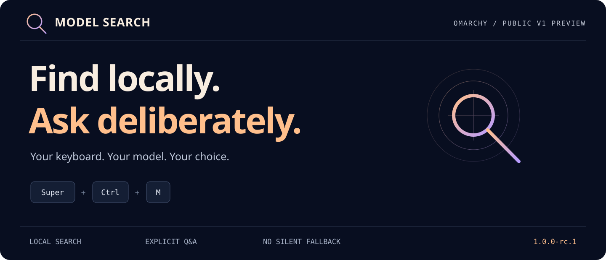
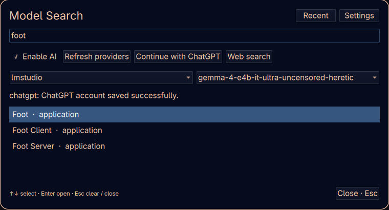
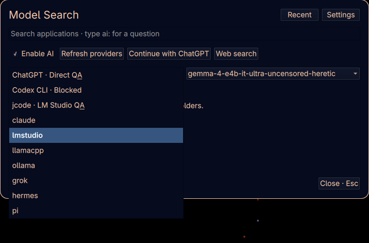
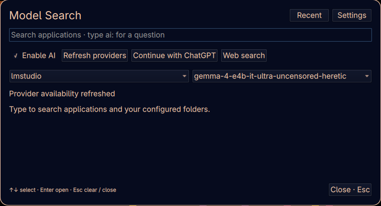

<p align="center"></p>

# Omarchy Model Search

**A keyboard-first search palette with a clear choice before AI.** Find applications and files locally. When you want an answer, explicitly choose ChatGPT or an available local model.

**Public preview · `1.0.0-rc.1` · MIT · 75 offline tests passing**

[Get started](docs/GETTING-STARTED.md) · [Release notes](CHANGELOG.md) · [Readiness](docs/VALIDATION.md) · [Security](SECURITY.md) · [Media kit](docs/marketing/README.md)

> **Preview status:** installed and validated on the authorized Omarchy lab VM. ChatGPT sign-in/model discovery and local model discovery are verified. Real inference, answer quality and latency are **not yet tested**. This is not the public 1.0 release.

## One palette, deliberate choices

- **Search without AI.** Match application names and filenames in folders you choose. Ordinary search does not send queries to a model.
- **Choose the destination.** ChatGPT comes first in the provider picker. The optional jcode route uses an explicitly selected, already loaded LM Studio model. No silent fallback.
- **Keep it Q&A.** The app exposes no agent tools, shell actions or desktop-control tools to AI. Blocked routes stay visibly unavailable.
- **Stay on the keyboard.** Open with `Super+Ctrl+M` on the lab setup, navigate results with arrows, activate with Enter and close with Escape.
- **Control the conversation.** Cancel a response, copy an answer, reopen recent conversations, or use a temporary question. Saved follow-ups remain bound to their original destination.
- **Start with what is installed.** Discovery never downloads models or starts model servers. New runtime/model downloads need owner approval.

## See the real app

These are unretouched region captures from VM333 at 1280×800. They show the current interface, not design mockups or generated answers.

### Local application search



### Explicit provider selection



### Your loaded local model



## What is ready

| Route / capability | Candidate status |
| --- | --- |
| Local app/file search | Implemented; keyboard and VM lifecycle checked |
| ChatGPT direct Q&A | Sign-in saved and authenticated catalog verified; live answers pending |
| jcode → LM Studio | Reviewed v0.94.0 runtime; synthetic text, tool-rejection and redirect checks passed; live answers pending |
| LM Studio direct | Loaded-model discovery verified; live answers pending |
| Codex CLI / Claude | Execution blocked; sign-in is not proof of safe execution |
| llama.cpp / Ollama | Offline adapters present; outside the focused active pair |
| Grok / Hermes / Pi | Detected but execution blocked |
| Colibri | Priority evaluation; not integrated or installed |

ChatGPT is a direct app connection. **It does not run Codex CLI.** jcode is an optional harness and still needs a model server; it does not replace LM Studio or shrink model weights.

## Try the preview candidate

The candidate is intended for an authorized lab environment. It still uses the official development clone ID `mp.emojis`; do not overwrite another plugin or treat it as a marketplace installation.

1. Read the [getting-started guide](docs/GETTING-STARTED.md) and [dependencies](docs/dependencies.md).
2. Review the [candidate install/removal instructions](docs/V1-RC.md).
3. On the existing VM333 installation, press **Super+Ctrl+M**.
4. Type an application name for local search. For AI, enable AI, explicitly choose a provider/model, and use the `ai:` prefix.

Use the [preview prerelease](https://github.com/mapski/omarchy.spotlight-AI.qsecofr/releases/tag/v1.0.0-rc.1) for the source-only archive and checksum. No weights, provider binaries, tokens, account state or history are bundled.

## Privacy and scope

Local search is independent of AI. Web search is an explicit browser action. Cloud questions go only to the selected cloud route; local questions use a verified loopback endpoint. The current VM setup reaches workstation LM Studio through an encrypted, temporary SSH tunnel—“local” does not mean the model runs inside the VM.

ChatGPT tokens are held in owner-restricted local files, separately from bounded conversation history. They are **not encrypted at rest**. Clear history does not sign out; plugin removal preserves private state. See [account/data controls](docs/GETTING-STARTED.md#accounts-and-data) and the [security boundary](SECURITY.md).

jcode runs with disposable configuration, no inherited provider credentials, no tools/MCP, and a relay enforcing the selected local destination. An unsolicited tool-response fixture is rejected. This is scoped verification, not a general security certification. [jcode details →](docs/JCODE.md)

## Development

```sh
python -m unittest discover -s tests -v
omarchy plugin validate .
```

Install requirements only with owner approval. The full test suite needs Node for JavaScript checks; QML lint needs the installed Omarchy shell imports. See [contributing](CONTRIBUTING.md) for the verification and release gates.

[Architecture](ARCHITECTURE.md) · [Roadmap](docs/ROADMAP.md) · [Known limits / FAQ](docs/FAQ.md) · [Validation evidence](docs/VALIDATION.md)

## License and credits

MIT. Built on the Omarchy overlay contract, with retained omaSearch/omAsk adaptations and attribution. Omarchy Spotlight informed the interaction direction; no Spotlight code is claimed as bundled. jcode is an optional external MIT runtime. See [LICENSE](LICENSE) and [third-party notices](THIRD_PARTY_NOTICES.md).

Independent community project; not an official OpenAI, LM Studio or Omarchy product. Product names belong to their respective owners.
